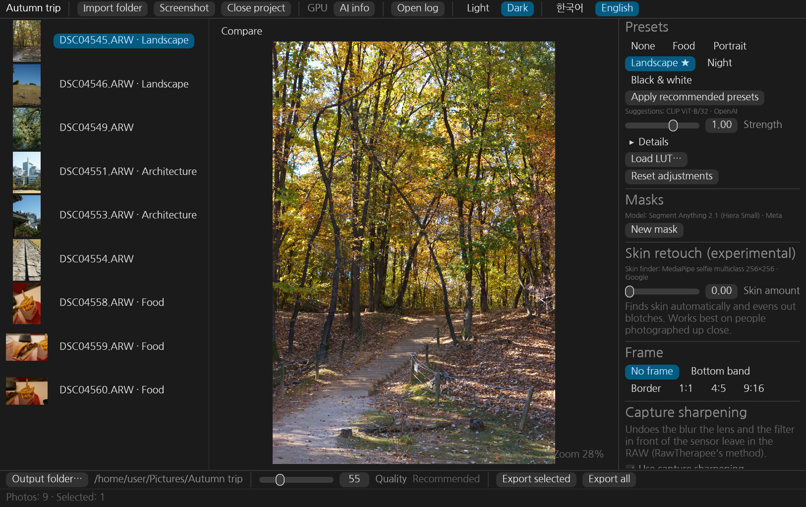

# Amsil (암실)

[한국어](README.md) | **English**

A Linux photo developer that batch-processes camera RAW files and exports compact 10-bit HEIF (HEVC).



## About

Import a folder of RAW photos, make adjustments, and export. Originals are never changed; edits are stored in a project file.

- **Compact output:** in one test, 309 24-megapixel photos (11 GB of RAW) exported to about 840 MB of HEIF.
- **Batch processing:** uses CPU cores and adjusts the number of simultaneous jobs to available memory.
- **Quick adjustments:** apply presets, compare before and after, or get preset suggestions based on image content.
- **Local AI:** preset suggestions, noise reduction, masks and skin retouch run downloaded models on your computer. Photos are never sent elsewhere.

## Quick start

Download `amsil-<version>-linux-x86_64.tar.gz` from the [releases page](https://github.com/desafin/amsil/releases), extract it, and run it.

```sh
tar xf amsil-*-linux-x86_64.tar.gz
cd amsil-*-linux-x86_64
./fetch-models.sh   # optional: download AI models (about 420 MB)
./amsil
```

For 64-bit Linux; Ubuntu 24.04 or a similarly recent distribution is recommended. Windows and macOS are not supported. Basic processing and export work without downloading the AI models.

## First export

1. Create a project file (`name.amsil`) with **[New project]**.
2. Import a folder of RAW photos with **[Import folder]**.
3. Select a photo and apply a preset in the right panel.
4. Choose an output folder and click **[Export all]**.

## Documentation

| Document | Contents |
|---|---|
| [User guide](docs/en/guide.md) | Workspace, controls, adjustments, output quality, file locations and logs |
| [Command line](docs/en/cli.md) | Folder conversion and all options |
| [AI models and sources](docs/en/ai-models.md) | Models, sources, licences and downloads |
| [Build from source](BUILD.md) | Development setup and build instructions (Korean) |
| [Third-party notices](THIRD-PARTY.md) | Open-source components included in the release |

## Licence

Amsil is licensed under GPL-3.0-or-later. See [LICENSE](LICENSE). The bundled Nanum Gothic font is under the [SIL Open Font License](assets/fonts/OFL.txt).
