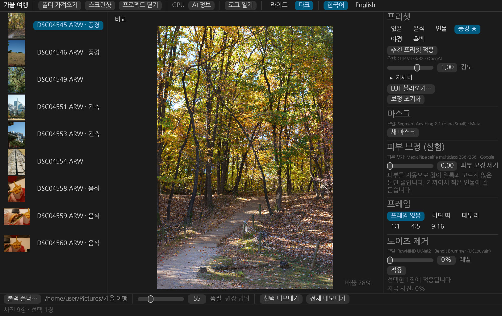

# 암실 (amsil)

**한국어** | [English](README.en.md)

카메라 RAW 사진을 한꺼번에 보정해 용량이 작은 HEIF(HEVC 10-bit)로 내보내는 Linux용 사진 현상 프로그램입니다.



## 암실은

RAW 사진 폴더를 가져와 빠르게 보정하고 내보냅니다. 사진 원본은 바꾸지 않고 보정 내용은 프로젝트 파일에 저장합니다.

- **작은 결과물:** 테스트에서 2,400만 화소 사진 309장(RAW 11GB)을 HEIF 약 840MB로 내보냈습니다.
- **빠른 일괄 처리:** CPU 코어를 활용해 여러 장을 처리하고, 메모리에 따라 동시 작업 수를 조절합니다.
- **간편한 보정:** 프리셋과 전후 비교를 제공하며, 사진 종류에 맞는 프리셋도 추천합니다.
- **로컬 AI:** 프리셋 추천, 노이즈 제거, 마스크, 피부 보정은 내려받은 모델을 이 컴퓨터에서 실행합니다. 사진은 외부로 전송되지 않습니다.

## 빠른 시작

[릴리스 페이지](https://github.com/desafin/amsil/releases)에서 `amsil-<버전>-linux-x86_64.tar.gz`를 받아 풀고 실행합니다.

```sh
tar xf amsil-*-linux-x86_64.tar.gz
cd amsil-*-linux-x86_64
./fetch-models.sh   # 선택 사항: AI 모델 받기 (약 420MB)
./amsil
```

64비트 Linux용이며 Ubuntu 24.04 이상 또는 비슷한 시기의 배포판을 권장합니다. Windows와 macOS는 지원하지 않습니다. AI 모델을 받지 않아도 기본 현상과 내보내기는 쓸 수 있습니다.

## 첫 변환

1. **[새 프로젝트]** 로 프로젝트 파일(`이름.amsil`)을 만듭니다.
2. **[폴더 가져오기]** 로 RAW 사진 폴더를 가져옵니다.
3. 사진을 고르고 오른쪽 패널에서 프리셋을 적용합니다.
4. 출력 폴더를 정한 뒤 **[전체 내보내기]** 를 누릅니다.

## 문서

| 문서 | 내용 |
|---|---|
| [사용 안내](docs/ko/guide.md) | 화면과 조작, 보정 기능, 출력 품질, 파일 위치와 로그 |
| [명령행 도구](docs/ko/cli.md) | 폴더 변환 및 전체 옵션 |
| [AI 모델과 출처](docs/ko/ai-models.md) | 모델, 출처, 라이선스 및 내려받기 정보 |
| [소스 빌드](BUILD.md) | 개발 환경과 빌드 방법 |
| [오픈소스 고지](THIRD-PARTY.md) | 배포물에 포함된 오픈소스 구성요소 |

## 라이선스

암실은 GPL-3.0-or-later를 따릅니다. 자세한 내용은 [LICENSE](LICENSE)를 참고하세요. 포함된 나눔고딕 글꼴은 [SIL Open Font License](assets/fonts/OFL.txt)를 따릅니다.
